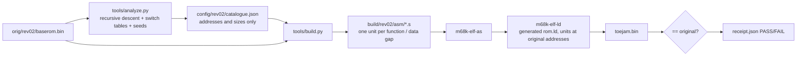

# ToeJam & Earl decompilation

<!-- Badges go live once ByteMatch has ingested a run (docs/BYTEMATCH.md):
[](https://bytematch.dev/mschienbein/toejam-earl-decomp)
[](https://bytematch.dev/mschienbein/toejam-earl-decomp)
-->
[](https://github.com/mschienbein/toejam-earl-decomp/actions/workflows/progress.yml)

A work-in-progress **matching decompilation** of *ToeJam & Earl* (Sega Genesis / Mega Drive, 1991,
Johnson Voorsanger Productions, `GM MK-1020`): C source that compiles back to the exact original ROM.

**Status:** harness milestone 1. Both retail revisions rebuild **byte-identically** from generated
GNU assembly (every instruction readable assembly, no raw words); no function is C yet, so matched
progress is 0. The next milestone is identifying the original C compiler ([docs/COMPILER.md](docs/COMPILER.md)).

| Revision | Role | Functions | Instructions | Code bytes | Rebuild |
|---|---|---:|---:|---:|---|
| REV 02 — *ToeJam & Earl (World) (Rev A)*, sha1 `85e8d0a4…` | primary target | 651 | 56,970 | 180,798 (17.2% of 1 MiB) | byte-identical |
| REV 00 — *ToeJam & Earl (World)*, sha1 `7f82d8b5…` | diff reference | 651 | 56,943 | 180,686 | byte-identical |

## Quick start

Needs Linux or macOS with a C compiler and make (for binutils), [uv](https://docs.astral.sh/uv/) and
your own dump of the game.

```sh
uv sync                                   # Python 3.12 + capstone, pyelftools (locked)
uv run python tools/setup.py              # builds GNU binutils 2.47 (m68k-elf, z80-elf) into .cache/
uv run python tools/rom.py import --rom "ToeJam & Earl (World) (Rev A).zip"   # -> orig/rev02/
uv run python tools/build.py              # -> build/rev02/toejam.bin + receipt.json (PASS)
uv run python -m unittest discover -s tests
```

`tools/rom.py import` accepts `.md`/`.bin`/`.gen` or a `.zip` holding one dump and identifies the
revision by SHA-256 (`config/title.json`). Use `--version rev00` with `analyze.py`/`build.py` for the
first release.

## How the build works



- `tools/analyze.py` follows control flow from the 68000 vectors and `config/<version>/seeds.json`,
  recognises the compiler's `switch` idiom (`cmpi/bgt/add/move.w tbl(pc,dn)/jmp tbl(pc,dn)`) and
  keeps its word-offset tables inside their function. Everything never reached as code stays data.
- `tools/build.py` renders code with capstone → GNU `as` syntax with symbolic branch, PC-relative
  and table targets, checks every instruction's size and bytes after assembling, and would fall
  back to raw `.short` words for any spelling that does not reproduce (none currently do). Data is
  `.incbin` from your private dump.
- The 67 seeds are the entry points of code that is only reached through pointers, taken from
  [bstreiff/tje-disasm](https://github.com/bstreiff/tje-disasm) (addresses only; see
  `docs/STATUS.md`). With them the catalogue covers every instruction that disassembly identifies.

## Layout

| Path | Contents |
|---|---|
| `tools/` | `setup.py` (toolchain), `rom.py` (identity/import), `analyze.py` (catalogue), `m68k.py` (decode/render), `build.py` (build + receipt) |
| `config/` | `title.json` (pinned dumps), `<version>/catalogue.json` and `seeds.json`, `matches.json` (accepted C, empty) |
| `ci/progress_report.py` | objdiff-format report for [ByteMatch](https://bytematch.dev), no ROM needed |
| `docs/` | [STATUS](docs/STATUS.md), [RESUME](docs/RESUME.md), [ACCEPTANCE](docs/ACCEPTANCE.md), [COMPILER](docs/COMPILER.md), [TOOLCHAIN](docs/TOOLCHAIN.md), [BYTEMATCH](docs/BYTEMATCH.md), `rulings/` |
| `tests/` | synthetic ROM tests (CI) + end-to-end real-ROM builds (skipped without `orig/`) |

## Legal

This repository contains no ROM data, extracted assets or original disassembly: only tools,
addresses, sizes and hashes. Generated assembly (`build/`) embeds ROM bytes and is git-ignored. You
need your own legally obtained copy of the game. ToeJam & Earl is a trademark of its owners; this
project is not affiliated with them or with Sega.
