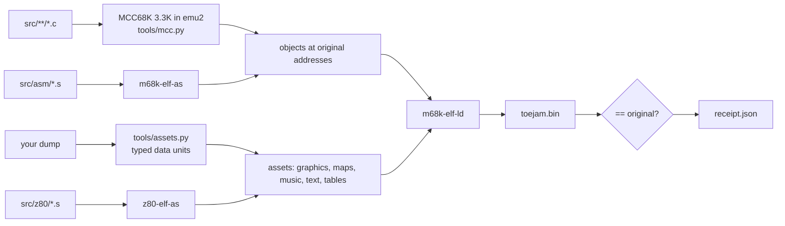

# ToeJam & Earl decompilation

[](https://bytematch.dev/mschienbein/toejam-earl-decomp) [](https://bytematch.dev/mschienbein/toejam-earl-decomp) [](https://bytematch.dev/mschienbein/toejam-earl-decomp)  
[](https://bytematch.dev/mschienbein/toejam-earl-decomp) [](https://bytematch.dev/mschienbein/toejam-earl-decomp) [](https://bytematch.dev/mschienbein/toejam-earl-decomp)  
[](https://github.com/mschienbein/toejam-earl-decomp/actions/workflows/progress.yml)

A **matching decompilation** of *ToeJam & Earl* (Sega Genesis / Mega Drive, 1991,
Johnson Voorsanger Productions, `GM MK-1020`): readable C and assembly sources that rebuild
both original retail ROMs byte for byte.

**Status: complete.** Both retail revisions rebuild **byte-identically** from this repository's
sources plus assets extracted from your own dump. All **598 of 598 C functions match (100%)**
in each revision, every remaining routine is readable assembly source, and both builds contain
**zero generated assembly**. Data is rebuilt from typed assets, except the Z80 driver (Z80
source) and 43 strings that the matched C functions emit from their own string literals; six
bytes without a known reader are explicitly typed `unreferenced`
([R012](docs/rulings/R012-closure-interpretations.md)).

The per-revision badges above are live (every push to `main` uploads a report to
[ByteMatch](https://bytematch.dev/mschienbein/toejam-earl-decomp)). C progress counts matched C
only: hand-written routines, compiler runtime helpers, and the five collision queries classified
under [R011](docs/rulings/R011-unreproducible-functions.md) are built from readable assembly and
counted separately. The typed-data badges count the data bytes covered by typed units (all but
the six `unreferenced` bytes, so they round to 100%).

| Part of the ROM | Built from | REV 02 | REV 00 |
|---|---|---|---|
| C functions (598 in each) | matched C in `src/` (MCC68K 3.3K) | **598 functions, 174,344 / 174,344 bytes (100%)** | **598 functions, 174,232 / 174,232 bytes (100%)** |
| 36 hand-written routines + 6 compiler runtime helpers | readable 68000 assembly, `src/asm/` (ruling [R007](docs/rulings/R007-assembly-sources.md)) | all 42 plus 3 fragments | all 42 plus 3 fragments |
| 5 collision queries, excluded from C progress under R011 | readable 68000 assembly, `src/asm/collision.s` ([ruling](docs/rulings/R011-unreproducible-functions.md)) | all 5, 1,068 bytes | all 5, 1,068 bytes |
| Z80 sound driver + boot stub (1,332 bytes) | Z80 assembly, `src/z80/` | all | all |
| Other data | typed assets extracted from your dump at build time (`docs/DATA.md`); 43 strings (2,330 bytes) come from the matched C's string literals (R012) | all 865,932 bytes (6 typed `unreferenced`) | all 866,044 bytes (6 typed `unreferenced`) |
| Generated assembly | none | **0 units** | **0 units** |

Both revisions build from the same sources; the per-build `REVISION` value covers their few
differences (eight bug fixes in REV 02, [docs/REVISIONS.md](docs/REVISIONS.md)), so a function
matched for one is checked and credited for both, and CI reports each revision to ByteMatch
separately. Completion evidence: [docs/STATUS.md](docs/STATUS.md); build and verification guide:
[docs/RESUME.md](docs/RESUME.md).

| Revision | Role | Functions | Rebuild |
|---|---|---:|---|
| REV 02 — *ToeJam & Earl (World) (Rev A)*, sha1 `85e8d0a4…` | primary target | 645 | byte-identical |
| REV 00 — *ToeJam & Earl (World)*, sha1 `7f82d8b5…` | same source, `REVISION` | 645 | byte-identical |

## Quick start

Needs Linux or macOS with a C compiler and make (for binutils and the emu2 DOS emulator),
[uv](https://docs.astral.sh/uv/) and your own dump of the game.

```sh
uv sync                                   # Python 3.12 + capstone, pyelftools (locked)
uv run python tools/setup.py              # binutils 2.47 (m68k-elf, z80-elf), emu2, Microtec MCC68K 3.3K
uv run python tools/rom.py import --rom "ToeJam & Earl (World) (Rev A).zip"   # -> orig/rev02/
uv run python tools/rom.py import --rom "ToeJam & Earl (World).zip"           # -> orig/rev00/
uv run python tools/build.py              # -> build/rev02/toejam.bin + receipt.json (PASS)
uv run python tools/build.py --version rev00
uv run python -m unittest discover -s tests
```

`tools/rom.py import` accepts `.md`/`.bin`/`.gen` or a `.zip` holding one dump and identifies the
revision by SHA-256 (`config/title.json`). Writing C: [docs/AUTHORING.md](docs/AUTHORING.md).

## How the build works



- The original game was compiled with **Microtec MCC68K 3.3K** (default options plus `/STRINTEXT`)
  and assembled with ASM68K; `docs/COMPILER.md` records how its output is reproduced.
- `config/sources.json` lists the source units; each replaces exactly the catalogued functions it
  defines. A C unit that does not compile to the original bytes fails the build.
- `tools/accept.py` turns matching sources into credit only through checkpoints: two fresh builds
  of both revisions, the test suite, an independent review, then `config/matches.json`.
- Every catalogued function and fragment now has C or readable assembly source. Both complete
  builds contain zero generated assembly units; the five R011 collision queries are not C credit.

## Layout

| Path | Contents |
|---|---|
| `src/` | matched C, one folder per subsystem; `src/asm/` readable 68000 assembly, `src/z80/` the Z80 driver |
| `include/` | K&R headers per subsystem: records, constants, RAM, assets, calls |
| `docs/subsystems/` | [how each subsystem works](docs/subsystems/README.md), with notes for a native port |
| `tools/` | toolchain setup, ROM import, catalogue, build, compiler driver, matcher, acceptance, public audit |
| `config/` | catalogues, names, classification, data units, sources, accepted matches per revision |
| `accept/` | checkpoint records (prepare, reviews, finalize) |
| `ci/progress_report.py` | objdiff-format report for [ByteMatch](https://bytematch.dev), no ROM needed |
| `docs/` | [STATUS](docs/STATUS.md), [RESUME](docs/RESUME.md), [AUTHORING](docs/AUTHORING.md), [ACCEPTANCE](docs/ACCEPTANCE.md), [COMPILER](docs/COMPILER.md), [DATA](docs/DATA.md), [QUALIFICATIONS](docs/QUALIFICATIONS.md), [TOOLCHAIN](docs/TOOLCHAIN.md), [BYTEMATCH](docs/BYTEMATCH.md), `docs/rulings/` |
| `tests/` | synthetic tests (CI) + real-ROM builds (skipped without `orig/`) |

## Credits and prior work

This project builds on two disassemblies of the game (ruling [R003](docs/rulings/R003-existing-work.md)):

- [bstreiff/tje-disasm](https://github.com/bstreiff/tje-disasm) (REV 02, GNU as): code map, labels,
  RAM variables, structure layouts, resource formats and the compiler-hunting notes;
- [RyanFaeScotland's ToeJam & Earl disassembly](https://bitbucket.org/RyanFaeScotland/toejamandearldisassembly)
  (REV 00, vasm; [project page](https://www.mybrillgamesite.com/projects/toejam-and-earl-disassembly)):
  commented menus, cutscenes, player controls, level seeds and presents.

Names, addresses, layouts and formats taken from them are restated here with per-entry provenance;
none of their source files are copied.

## Legal

This repository contains no ROM data, extracted assets or generated disassembly: only
reconstructed source (C, and readable assembly under rulings R007 and R011),
tools, addresses, sizes and hashes. Build outputs (`build/`) embed ROM bytes and are git-ignored;
`tools/audit_public.py` checks every commit. You need your own legally obtained copy of the game. ToeJam & Earl is a trademark of its owners; this
project is not affiliated with them or with Sega.
